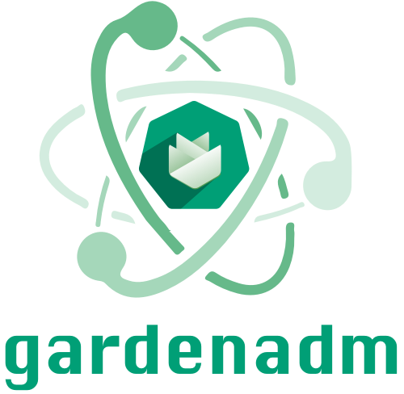
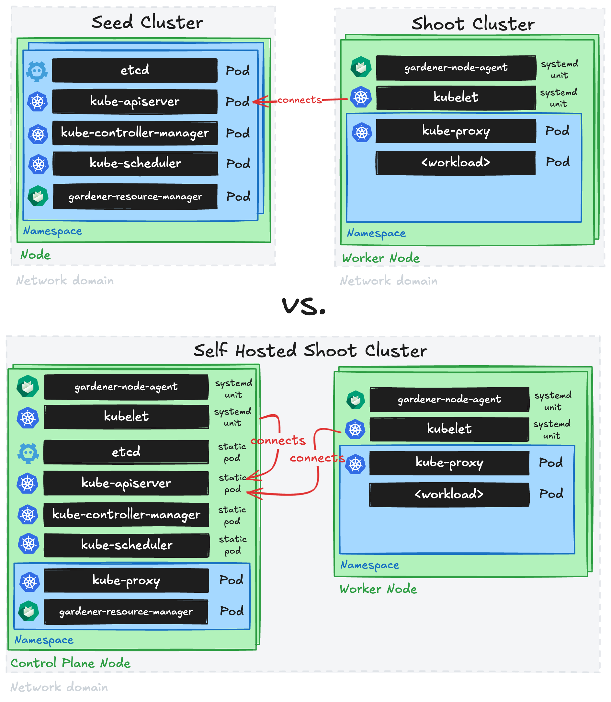

> [!CAUTION]
> This tool is currently under development and considered highly experimental.
> Do not use it in production environments.
> Read more about it in [GEP-0028](https://github.com/gardener/enhancements/tree/main/geps/0028-self-hosted-shoot-clusters).

## Overview

`gardenadm` is a command line tool for bootstrapping Kubernetes clusters called "Self-Hosted Shoot Clusters".
In contrast to usual Gardener-managed clusters (called Shoot Clusters), the Kubernetes control plane components run as static pods on a dedicated control plane worker pool in the cluster itself (instead of running them as pods on another Kubernetes cluster (called Seed Cluster)).
Self-hosted shoot clusters can be bootstrapped without an existing Gardener installation.
Hence, they can host a Gardener installation itself and/or serve as the initial seed cluster of a Gardener installation.
Furthermore, self-hosted shoot clusters can only be created by the `gardenadm` tool and not via an API of an existing Gardener system.

Such self-hosted shoot clusters are meant to operate autonomously, but not to exist completely independently of Gardener.
Hence, after their initial creation, they are connected to an existing Gardener system such that the established cluster management functionality via the `Shoot` API can be applied.
I.e., day-2 operations for self-hosted shoot clusters are only supported after connecting them to a Gardener system.
This Gardener system could also run in a self-hosted shoot cluster itself (in this case, you would first need to deploy it before being able to connect the self-hosted shoot cluster to it).

Furthermore, self-hosted shoot clusters are not considered a replacement or alternative for regular shoot clusters.
They should be only used for special use-cases or requirements as creating them is more complex and as their costs will most likely be higher (since control plane nodes are typically not fully utilized in such architecture).
In this light, a high cluster creation/deletion churn rate is neither expected nor in scope.

## Getting Started Locally

[This document](../deployment/getting_started_locally_with_gardenadm.md) walks you through deploying Self-Hosted Shoot Clusters using `gardenadm` on your local machine.
This setup can be used for trying out and developing `gardenadm` locally without additional infrastructure.
The setup is also used for running e2e tests for `gardenadm` in CI.

## Scenarios

We distinguish between two different scenarios for bootstrapping self-hosted shoot clusters:

- Unmanaged Infrastructure, meaning that there is no programmable infrastructure available.
  We consider this the "bare metal" or "edge" use-case, where at first machines must be (often manually) prepared by human operators.
  In this case, network setup (e.g., VPCs, subnets, route tables, etc.) and machine management are out of scope.
- Managed Infrastructure, meaning that there is programmable infrastructure available where we can leverage [provider extensions](../../extensions/README.md#infrastructure-provider) and [`machine-controller-manager`](https://github.com/gardener/machine-controller-manager) in order to manage the network setup and the machines.

The general procedure of bootstrapping a self-hosted shoot cluster is similar in both scenarios.

## Control Plane Exposure and DNS

The API server of a self-hosted shoot cluster is accessible via the external domain `api.<spec.dns.domain>`.
How the external domain is managed depends on the `spec.provider.workers[].controlPlane.exposure` configuration of the control plane worker pool (see [GEP-0036](https://github.com/gardener/enhancements/tree/main/geps/0036-self-hosted-shoot-exposure)):

- If the control plane is exposed (via `exposure.extension` or `exposure.dns`), Gardener manages the DNS records of the cluster.
  For shoots with managed infrastructure, Gardener additionally manages an internal `DNSRecord` for the domain `api.internal.<spec.dns.domain>` pointing to the internal IPs of the healthy control plane nodes.
  Components on the nodes (e.g., `gardener-node-agent`, `kubelet`, and `kube-proxy`) talk to the control plane via the internal domain instead of the external domain.
  On the control plane nodes, `kubelet` and `kube-proxy` talk to the local API server via `localhost` instead.
  This prevents a split-brain scenario if the exposure (e.g., a load balancer) breaks: the worker nodes could no longer talk to the control plane while the control plane components still can, which might lead to the termination of the worker nodes.
  Accordingly, `gardenadm token create --print-join-command` prints the internal domain for joining nodes.
- If the control plane is not exposed, the external domain is managed outside of Gardener, i.e., the operator is responsible for setting up the DNS record `api.<spec.dns.domain>` pointing to the control plane nodes or an external load balancer.
  In this case, there is no internal domain and the components on the nodes talk to the control plane via the external domain.
